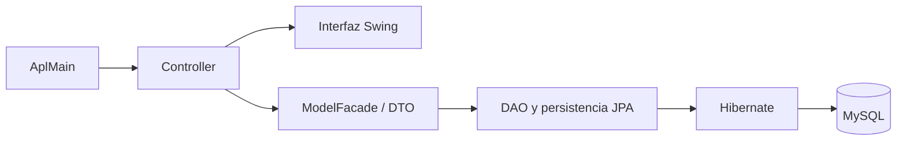

# Sistema de gestión para papelería

Aplicación de escritorio para administrar operaciones de una papelería, con módulos de inventario, ventas, clientes, proveedores, cuentas y reportes.


## Contexto académico

Proyecto grupal de **Ingeniería de Software I**, semestre **5**, periodo **2025-2**, en la **Universidad El Bosque**. La programación de todo el código estuvo a cargo de un integrante del grupo.

El sistema corresponde a un caso académico de gestión de una papelería. Incluye gestión de clientes, proveedores, productos e inventario, ventas, cuentas por cobrar y pagar, y reportes.

## Tecnologías

| Área | Tecnologías |
|---|---|
| Lenguaje e interfaz | Java 21, Swing |
| Persistencia | Jakarta Persistence (JPA), Hibernate, MySQL Connector/J |
| Documentos | iText |
| Construcción | Maven |

## Arquitectura

El punto de entrada `AplMain` crea el controlador, que conecta la interfaz Swing con el modelo y las clases DAO. La persistencia utiliza JPA, Hibernate y MySQL.



## Estructura

```text
.
├── src/main/java/co/edu/unbosque/
│   ├── controller/
│   ├── model/
│   ├── model/persistence/
│   ├── util/
│   └── view/
├── src/main/resources/META-INF/persistence.xml
└── pom.xml
```

## Requisitos

- JDK 21
- Maven 3.9 o posterior
- MySQL compatible con MySQL Connector/J 8.0

## Compilación y ejecución

1. Crea la base de datos MySQL indicada por `PAPELERIA_DB_URL` y define las variables de conexión `PAPELERIA_DB_URL`, `PAPELERIA_DB_USER` y `PAPELERIA_DB_PASSWORD`. `.env.example` contiene los nombres y valores de referencia; la aplicación lee las variables del entorno del proceso.
2. Compila el JAR ejecutable:

   ```bash
   mvn clean package
   ```

3. Inicia la aplicación:

   ```bash
   java -jar target/Proyecto_Software-0.0.1-SNAPSHOT.jar
   ```

En Eclipse, importa la carpeta como proyecto Maven, define las tres variables en la configuración de ejecución y ejecuta `co.edu.unbosque.controller.AplMain` como aplicación Java.

